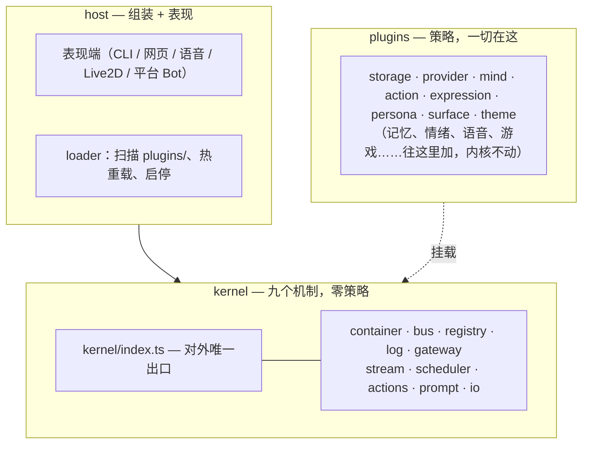
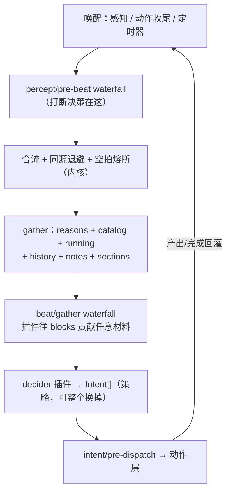
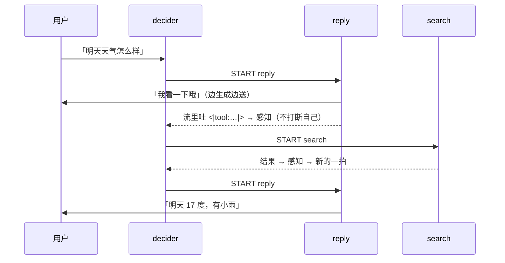

# MindCore 架构方案

> 版本：v0.3 · 2026-08-17 · 需求：[mindcore-requirements.md](mindcore-requirements.md) · **本文是 v0.3 上层方案，与 [handbook.md](handbook.md) 不一致处以 handbook 为准**
> **代号沐沐（Mumu），已落地实现**：[../](../) · 零运行时依赖 · 测试以 `npm test` 为准
>
> **本文只谈架构与取舍。** 项目全部约定、决策记忆、代码风格、当前状态 →
> [handbook.md](handbook.md)（接手先读那篇）；
> 内核每个机制怎么用 → [kernel.md](kernel.md)；
> 内核机制的完整论述与定档契约 → [architecture-paper.md](architecture-paper.md)。
>
> v0.3 修订：同步「通用化重构」。核心变动是**输出端开放化**（v0.2 的输入开放、输出封闭是设计缺陷）
> 与**一拍材料开放化**。v0.1 的开放问题全部撤销——它们都是插件内部事务。

---

## 0. 立场

内核提供**机制**，插件提供**策略**。

> **判据只有一句：换一个插件能不能换掉它？**
> 能 → 它是插件。不能（它是插件赖以存在的地基）→ 它是内核。

内核不认识任何：provider、动作、表情、会话形态、模态、存储介质、任何一句中文渲染。

刻意没做的：不把现成框架整个搬进来当内核；不要 turn / step 节拍；不做多段式配置协商与按区域细分的权限；不用正则解析决策、非流式发言、`wait` 当动作。

---

## 1. 分层



三条硬规则：

1. 内核不依赖 Host，不知道有没有屏幕和声音；**对外只经 `kernel/index.ts` 一个出口**，内部重构不外溢（有边界测试守着）。
2. `Percept` / `Part` 是内核与表现端之间的唯一契约。
3. 同进程直连；跨进程（浏览器跑 Live2D）走同一份事件流 —— **是装配差异，不是代码差异**。

---

## 2. 输入输出：两端对称的开放信封 ★

这是全套设计里最关键的一条，也是 v0.2 → v0.3 修掉的最大缺陷。

```
Percept { kind: string, channel?, sender?, text?, urgent?, data? }   ← 进
Part    { kind: string, text?, data? }                               ← 出
```

`kind` 两边都是**自由字符串**：`message` / `danmaku` / `vision.frame` / `file` / `image` / `card` / `game.cmd`……内核**一个都不认识**，语义由插件定义。

固定的只有**节拍**（这才是机制），而且**两端都是流**：

```
进：Perception = 若干 update → end   或中途 cancel   语音逐字、边打边改
出：Utterance  = 若干 part   → end   或中途 stop     发言被打断
```

一次性输入（消息、事件）用 `percept()` 不必开流。`update` 是修订不是追加——
ASR partial 后一次覆盖前一次；修订能表达追加，反之不能。

**v0.2 的错误**：`Percept.kind` 开放，`Expression` 却是 `speech.chunk | marker | stop` 封闭联合。`speech` 这个词本身就是模态假设——加图片、音频帧、游戏指令都要改内核。**输入开放而输出封闭，是伪装成通用的具体。**

### 内核唯一允许"认识"的东西：结构位

| 结构位 | 内核用它做什么 |
|---|---|
| `Percept.text` + `sender` | 进对话历史（other 侧） |
| `Percept.channel` | 路由表现端；打断只切本频道 |
| `Percept.urgent` | 默认打断策略的唯一依据 |
| `Part.text` | **只有它计入送达账** |
| `Surface.channels` / `capabilities` | 谁收得到、按回执还是按全量记账 |

### 能力降级只有一条规则

**表现端不认识的 `Part.kind` 直接忽略。** 没有第二条。

### 会话形态不是内核的事

群聊、私聊、弹幕、视觉、听觉、文件……都只是 `kind` + `channel` + `sender` 的组合。加一种会话形态 = 写一个表现端插件，内核零改动。

---

## 3. 心流：Beat 模型

一拍 = 一次主大脑睁眼：汇聚材料 → decider 给意图 → 派发动作。
**Beat 本身不产生任何面向用户的输出**；输出全由动作实例产生。



### 材料是开放的

内核只填自己知道的部分（reasons / catalog / running / history / notes / sections），然后过 `beat/gather` waterfall，插件往 `blocks` 里贡献任意材料：

```
MaterialBlock { from, order?, text, data? }
    text = 任何 decider 都能渲染的自然语言
    data = 给认识它的 decider 的结构化载荷
```

记忆、情绪、外部状态都走这条路，**内核不必认识它们**。

**v0.2 的错误**：`BeatMaterial` 内核写死七个字段——装一个记忆插件却喂不进主大脑，直接违背「一切即插件」。

### Beat 风暴三重防护

- **合流**：冷却窗口内的唤醒合成一拍，原因结构化累积
- **同源指数退避**：内生唤醒（动作收尾）逐次放缓；外部唤醒永不退避
- **空拍熔断**：连续空拍 → 只听外部唤醒，杜绝自激振荡

### wait 不是动作

空意图 + `wakeAfterMs` 定时器 = 等待。新事件直接作废定时器。

原型里 `wait` 是动作，导致占槽位、要特判「打断 wait」、「连续 wait」要专门计数——改成内核状态后全部消失。

### 主大脑不说话

Director 编排，Performer 发言。这是原型里最正确的一个决定，完整保留。好处：Director 输出短（几十 token）可用贵模型且延迟可控；Performer 被硬打断不影响 Director 状态机；「说话中并行做事」自然成立。

---

## 4. 流式与打断

### 说话中做事 = 并行动作，不是串行 loop



### 双向打断

| 方向 | 机制 |
|---|---|
| **对方打断角色** | `urgent` ⇒ abort utterance → 表现端停止呈现 → **回报实际送达前缀** → 记 `utterance.settled { delivered, truncated, cause }` |
| **角色打断对方** | 在途感知进 `BeatMaterial.incoming`，decider 看得见「说了多久、说到哪」，可直接 `start reply` 插话 |

流式输入的唤醒按需（`update(text, {wake:true})` 才开一拍），否则每个字一拍会烧钱；
什么时候值得唤醒（停顿、关键词、说太久）是表现端/插件的策略。

- **Soft**：新信息进下一拍，不停当前话

**为什么必须有**：没有它，日志记的是模型生成全文，但用户只听到前缀 → 下一轮模型以为自己说过了 → 接话必错。

送达账的通用规则：**只有 `Part.text` 计入**（文本线性可截断，其余片段原子）。这样 I2 在任何模态下都成立。

---

## 5. 日志：唯一真源

append-only 事件序列。模型历史、UI、回放全部从它投影，不存在第二份状态。落盘是**插件**的事（storage seam）。

三条不变量（运行时保证）：

- **I1** 模型可见 ⟺ 已记录
- **I2** 说出去的 ⟺ 记录**实际送达的部分**
- **I3** `action.started` 必有 `action.ended`（孤儿恢复为 interrupted，并变成角色的「自我察觉」）

观察口：`log.appended` emit 事件——UI、遥测、记忆写入等**纯投影**消费方监听它。要**改**行为用 waterfall，要**看**事实用 emit。

---

## 6. 插件系统

### 一个插件一个目录

```
plugins/                     任意分层归类（官方/用户/按功能），层数不限
├─ official/<id>/            有 package.json 的目录即插件
└─ user/…/<id>/
    ├─ package.json   + mumu: { enabled, order, description, defaults }
    ├─ README.md · index.ts（default 导出 Plugin）· node_modules/
```

loader 递归扫描自动装配，**入口不写死任何插件**。
**目录是组织，不是身份**：id 由 package.json 决定，与路径无关——插件挪窝不丢配置、不断命令，
加载次序只看 `order`。id 冲突大声失败。热加载两条路：`/plugin reload <id>` 手动，或改文件自动重载（fs.watch）。

启动分两段：**引导段**（`order < 0`，如存储插件，配置只来自自己的清单 defaults）→ 配置库就绪 → **常规段**。

### 三种交互形态

| 形态 | 机制 | 例 |
|---|---|---|
| **Service** | 占 `ctx.<key>`，直接调用 | `ctx.model` · `config` |
| **Event** | `emit` 观察 / `waterfall` 拦截 | 听 `log.appended` 写记忆 |
| **Contribution** | 往 `Registry` 里放东西 | 段落、动作、marker 词汇、材料块 |

**Contribution 最被低估**：人格、表情、记忆各贡献一段，谁也不 import 谁，组装器拼成连贯提示词。这比让插件互相调用健壮得多。

`Registry<T>` 是通用机制，**插件也能开自己的集合**：`ctx.provide('myThing', new Registry(...))` 即是一个新扩展点。

### 插件改插件

不需要专门机制，三条既有通道覆盖：

1. **一切策略过 waterfall** —— 后装的插件可改写先装插件的行为
2. **服务可替换** —— `ctx.<key>` 是槽位，占掉 `mind` 槽 = 整个换脑
3. **Contribution 可叠加** —— 给别人的动作补词汇、在别人的段落之上再贡献一段

约定：**插件自己的可改点也用 waterfall 暴露**（如 surface-cli 的 `cli/render`），别人改你不需要 import 你。`theme-soft` 是现成示例。

### 扩展点全表

| 水线 | terminal（默认行为） |
|---|---|
| `percept/pre-beat` | urgent ⇒ 硬停本频道发声；`wake:false` 压制唤醒 |
| `beat/gather` | 原样返回；插件往 blocks 贡献 |
| `intent/pre-dispatch` | 执行 start/send/stop；`allow:false` 拦截 |
| `expression/pre-emit` | 原样放行；`drop:true` 吞掉 |

### 配置

**内核裸启动：没有配置文件，也没有环境变量。** 配置只有两层——

```
插件 package.json 的 mumu.defaults   默认值，随插件走（装上即可用）
配置库 plugins.<id>.*                覆盖值，/config set 写入
```

**默认在插件、覆盖在库**：空库即全默认，无需播种。改配置写库后，装配层**精确重载那一个插件**，即时生效。

这条纪律一直贯到底：装配层不认识任何具体配置键，连模型 `roles` 都由 provider 插件自己绑——内核与装配层都不为哪家模型开特例。

---

## 7. 现状与推迟

**已实现**：九机制内核 · 插件目录化自组装 + 热加载 · SQLite 存储与配置库 · 8 个官方插件（Web 表现端 v1 已删，v2 见 [periphery.md](periphery.md)）· 真 API 端到端验证（流式对话、说话中硬打断且 delivered 逐字正确、运行时启用主题插件改样式、fs.watch 自动热重载）。

Web 表现端是 `log.appended` 观察口的第一个消费方，也是「UI 从真源投影、不持第二份状态」的示范：SSE 先重放存量再直播，页面渲染完回报送达。

**推迟**（每一项都验证过「回来时内核不动」）：

| 推迟项 | 回来时的形态 |
|---|---|
| 情绪状态演化 | 插件：听 `log.appended` + 自有状态 + `beat/gather` 贡献 block |
| 记忆 | 插件：`ctx.memory` 服务 + 惰性段落 + 听日志写入 |
| 分级思考 / 内省 | decider 插件内部演化，或整个换掉 |
| 语音 / VAD / 端点判断 | surface 插件 + `percept/pre-beat` 拦截 |
| Live2D / 3D / 游戏 | surface 插件；跨进程时才引入 Kit + 独立 protocol 包 |
| 群聊 / 弹幕平台 | surface 插件，自己的 kind/channel/sender |
| 工具注册表（函数式） | 目前「工具即动作」；真需要再开 `ctx.tools` |
| 权限 / 沙箱 | 容器加能力裁剪，装第三方插件那天再说 |
| 多实例 / 跨实例通讯 | `Mumu.create()` 已支持多棵树；Spark 类信号真需要再加 |

**v0.1 遗留的「待拍板」全部撤销** —— 它们都是插件内部事务，不再是架构问题：
Gate 层要不要 · marker 词汇有哪些 · 情绪维度全局还是按对象 · 日志归档 · 多人格是否共享记忆 · 内省默认开关 · 并发工具上限。

---

## 8. 需求对照

| 需求文档待定项 | 结论 |
|---|---|
| 心流 / 统一中枢 | §3 Beat 模型（合流/退避/熔断、开放材料、wait 不是动作、主大脑不说话） |
| 内核 ↔ 表现端协议 | §2 两端对称开放信封 + 结构位 + 一条降级规则 |
| 内核模块划分与选型 | §1 九机制；Node 22+ / ESM / 零运行时依赖 / SQLite / node:test |
| 插件机制 | §6 目录化自组装、热加载、三种交互、插件改插件、扩展点表 |
| 反射与情绪 | 反射 = `percept/pre-beat` 上的插件；情绪 = 听日志 + 贡献 block 的插件（推迟） |
| 记忆系统 | 插件：服务 + 惰性段落 + `beat/gather`（推迟） |
| 多模型协同 | 角色绑定网关（`mind.decide` / `performer` / 插件自定义角色）；§4 说话中并行做事 |
| 仓库结构与路线 | [handbook.md](handbook.md) §3、§12 |
